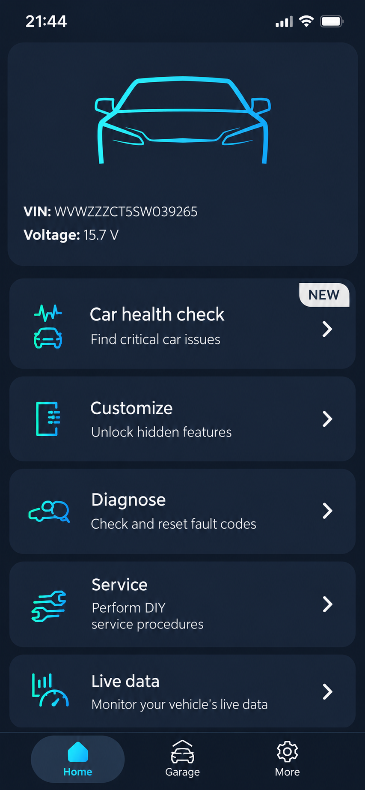
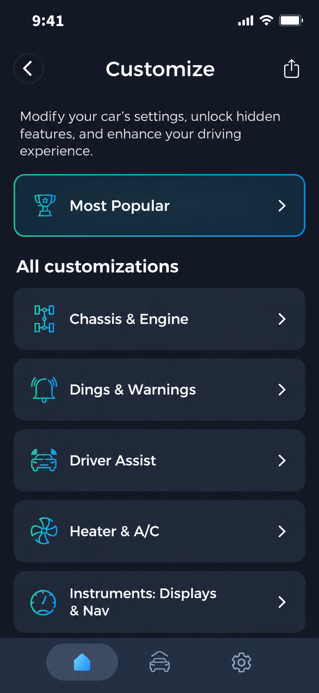
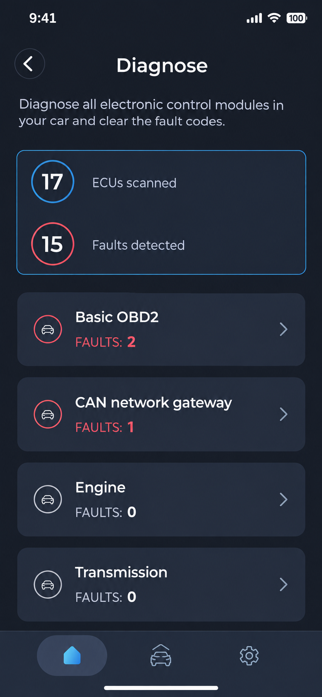

# Carista Vehicle Compatibility - OBD2 Vehicle Support Reference



**Carista OBD2** maintains **Carista Vehicle Compatibility**, a technical reference for examining vehicle families, ECU fingerprints, CAN definitions, and model-dependent support.

[](https://carista-obd2.github.io/carista-vehicle-compatibility/carista-OBD2)

## Documentation

The primary references for Carista OBD2 are:

- [Supported vehicle data](docs/CARS.md)
- [Vehicle integration checklist](docs/CAR_PORTING_CHECKLIST.md)
- [Vehicle template](opendbc/car/CARS_template.md)
- [Contribution guidelines](CONTRIBUTING.md)
- [Security policy](SECURITY.md)

Carista Vehicle Compatibility combines vehicle definitions with Python interfaces for CAN parsing, ECU identification, firmware matching, and platform validation.

### What is the meaning of Carista?

Carista is the name of an automotive hardware and smartphone software system used for vehicle diagnostics, customization, and service operations. In this repository, Carista identifies the application being researched rather than a protocol, CAN standard, or Python package. Carista OBD2 is the organization name, while Carista Vehicle Compatibility is the repository dedicated to model-dependent support information.

## Features

Carista Vehicle Compatibility focuses on the technical foundations needed to evaluate Carista features:

- ECU firmware identification and vehicle fingerprinting.
- CAN message parsing and construction.
- Vehicle-state interfaces for supported code families.
- ISO-TP and UDS communication primitives.
- Model documentation and compatibility tests.
- Brand-specific values, interfaces, and CAN helpers.
- Validation workflows for compatibility changes.



These components can inform research into a Carista diagnostic session, Carista live data, Carista fault code reader behavior, Carista check engine light workflows, Carista service reset support, and Carista battery registration.

### Connection types

Carista normally communicates through a compatible Bluetooth OBD2 device connected to a vehicle. Relevant search paths include Carista Bluetooth, Carista OBD2 adapter, Carista EVO adapter, Carista OBD reader, and Carista OBD2 scanner.

The retained code models lower-level CAN, ISO-TP, UDS, ECU addressing, and firmware-query behavior. It does not include a complete ELM327 emulator, MQTT pipeline, mobile interface, or the proprietary Carista scanner transport implementation.

### Functionality

The source material describes common automotive diagnostic operations such as:

- Reading and clearing diagnostic trouble codes.
- Reading vehicle and ECU information.
- Monitoring live parameters.
- Identifying vehicles from ECU firmware.
- Parsing and constructing CAN messages.
- Recording compatibility data.
- Testing brand-specific vehicle interfaces.

Carista car coding and Carista customization can alter persistent vehicle settings. Diagnostic reads are generally less invasive, but coding, service, and ECU write operations can cause unexpected behavior when applied to an unsupported configuration.

### Compatibility Vocabulary

carista obd2, carista evo, carista pro, carista diagnostics, carista vehicle compatibility, obd2, automotive, vehicle-diagnostics, car-diagnostics, vehicle-compatibility, car-customization, elm327

### Is a Carista worth it?

Carista may be worthwhile when the desired Carista features are explicitly available for the exact make, model, year, ECU, and adapter combination. Drivers interested in recurring diagnostics, supported customization, or service procedures may receive more value than drivers who only need a one-time generic fault-code scan.

Carista Vehicle Compatibility cannot make that decision from a brand name alone. Review the vehicle definitions, identify the required operation, and account for the Carista subscription before purchasing hardware. A Carista scanner is only useful when both the adapter and software support the intended vehicle function.

## Supported devices

| Device category | Intended role | Compatibility note |
|---|---|---|
| Carista OBD2 adapter | Smartphone-to-vehicle communication | Confirm support for the vehicle and required feature |
| Carista EVO adapter | Newer Carista hardware path | Feature availability remains model-dependent |
| Bluetooth OBD2 adapter | Wireless diagnostic transport | Generic compatibility does not imply advanced Carista support |
| ELM327-style adapter | Standard diagnostic communication | Adapter quality and command support vary |
| CAN development interface | Engineering and validation | Not a substitute for the consumer Carista workflow |

Carista OBD2 hardware should be connected only when the vehicle is safely parked. Avoid ECU configuration changes while voltage is unstable or while the vehicle is moving.

## Supported cars

The selected Carista Vehicle Compatibility code contains interfaces for several vehicle families. Use [the generated vehicle reference](docs/CARS.md) as the repository-level source of truth.

| Vehicle family | Relevant files | Common Carista searches |
|---|---|---|
| Toyota and Lexus | [Toyota values](opendbc/car/toyota/values.py), [Toyota fingerprints](opendbc/car/toyota/fingerprints.py) | Carista Toyota, Carista Lexus, Carista 4Runner, Carista Tacoma, Carista Tundra, Carista RAV4, Carista Prius, Carista Toyota Corolla, Carista GR Yaris |
| Volkswagen Group | [Volkswagen values](opendbc/car/volkswagen/values.py), [Volkswagen fingerprints](opendbc/car/volkswagen/fingerprints.py) | Carista VW, Carista Golf MK7, Carista VW T6, Carista VW Tiguan, Carista Seat Leon, Carista Skoda, Carista Skoda Octavia |
| Ford | [Ford values](opendbc/car/ford/values.py), [Ford fingerprints](opendbc/car/ford/fingerprints.py) | Carista Ford |
| General Motors | [GM values](opendbc/car/gm/values.py), [GM fingerprints](opendbc/car/gm/fingerprints.py) | Vehicle-specific Carista diagnostics must be verified |
| Honda | [Honda values](opendbc/car/honda/values.py), [Honda fingerprints](opendbc/car/honda/fingerprints.py) | Carista Honda |
| Hyundai | [Hyundai values](opendbc/car/hyundai/values.py), [Hyundai fingerprints](opendbc/car/hyundai/fingerprints.py) | Carista Hyundai, Carista Kia |
| Mazda | [Mazda values](opendbc/car/mazda/values.py), [Mazda fingerprints](opendbc/car/mazda/fingerprints.py) | Carista Mazda |

Search interest also includes Carista Audi, Carista BMW, Carista Mercedes, Carista Nissan, Carista Volvo, and Carista Subaru. Those names are not represented by brand-specific modules in this selected repository snapshot. The absence of a module does not establish that the commercial application lacks support, just as the presence of code does not establish Carista feature availability.

Specific searches such as Carista Audi A3, Carista Audi A4, Carista Audi Q5, Carista BMW E90, and Carista Nissan Qashqai require independent model-year confirmation.

### How much does Carista cost?

The repository does not define a Carista price, Carista subscription price, regional tax, trial, or Carista discount code. Those commercial terms can change independently of the compatibility code and may differ by platform or country.

The total cost can include a Carista adapter or Carista EVO adapter plus access to paid Carista Pro functionality. Evaluate the required feature and vehicle compatibility before comparing prices. Carista Vehicle Compatibility intentionally avoids publishing an amount that cannot be verified from the retained files.

### What's better, Carly or Carista?

The better choice depends on the exact vehicle and intended operation rather than the product name alone. Carista should be evaluated by checking whether its diagnostics, customization, live data, and service functions support the target model and year.

Carista Vehicle Compatibility does not contain a controlled comparison with Carly, so it cannot substantiate a universal winner. Compare verified vehicle coverage, required hardware, subscription terms, and the exact procedures you need. For this repository, the documented scope remains Carista OBD2 and not another commercial product.

## Requirements

Development and validation of Carista Vehicle Compatibility require:

- A supported Python environment defined by [pyproject.toml](pyproject.toml).
- Dependencies locked in [uv.lock](uv.lock).
- Appropriate CAN or diagnostic hardware for real-vehicle testing.
- Knowledge of OBD2, CAN, ECU addressing, ISO-TP, and UDS.
- A stable vehicle power supply for hardware validation.
- A safe test environment with the vehicle stationary.

## Quick start

Start with the vehicle catalog and the relevant brand definition. Compare the target platform against firmware fingerprints, interface values, and existing tests before proposing a compatibility change.

```text
docs/CARS.md
opendbc/car/<brand>/values.py
opendbc/car/<brand>/fingerprints.py
opendbc/car/<brand>/interface.py
```

Follow [the vehicle integration checklist](docs/CAR_PORTING_CHECKLIST.md) before treating a new model as supported. Carista supported cars and repository-supported interfaces are related research concepts, but they are not interchangeable claims.

## Project Structure

```text
docs/
├── CARS.md
└── CAR_PORTING_CHECKLIST.md

opendbc/
├── can/
│   ├── dbc.py
│   ├── packer.py
│   └── parser.py
└── car/
    ├── common/
    ├── ford/
    ├── gm/
    ├── honda/
    ├── hyundai/
    ├── mazda/
    ├── toyota/
    └── volkswagen/
```

- [CAN parser](opendbc/can/parser.py) interprets messages from DBC definitions.
- [CAN packer](opendbc/can/packer.py) constructs messages from signal values.
- [Vehicle helpers](opendbc/car/car_helpers.py) coordinate supported interfaces.
- [Firmware versions](opendbc/car/fw_versions.py) support ECU identification.
- [Vehicle fingerprints](opendbc/car/fingerprints.py) support platform matching.
- [VIN handling](opendbc/car/vin.py) handles vehicle identification data.
- [UDS support](opendbc/car/uds.py) provides diagnostic service primitives.

## Architecture



```text
Carista Vehicle Compatibility
          │
          ├── Vehicle documentation
          ├── ECU firmware fingerprints
          ├── Brand-specific interfaces
          ├── CAN parser and packer
          └── ISO-TP and UDS primitives
```

The high-level vehicle layer uses [interfaces](opendbc/car/interfaces.py), [structures](opendbc/car/structs.py), and [shared values](opendbc/car/values.py). Brand modules supply platform definitions, CAN helpers, vehicle state parsing, and controller logic.

## DBC file basics

A DBC file describes CAN messages and signals in a human-readable format. A vehicle can use multiple CAN buses, each with its own messages, units, scaling, and ECU participants.

Carista Vehicle Compatibility uses CAN definitions as technical context for understanding vehicle state and platform differences. DBC coverage alone does not confirm that a Carista diagnostic or Carista customization option is exposed by the commercial application.

## How to start reverse engineering cars

Begin with passive observation in a controlled environment. Record known vehicle states, identify changing CAN signals, compare related platforms, and document uncertainty.

Do not transmit messages until their purpose, range, checksum, counter behavior, and safety impact are understood. Use [the compatibility checklist](docs/CAR_PORTING_CHECKLIST.md) before contributing a vehicle definition.

## How to use reverse engineered DBC

DBC definitions can parse recorded CAN traffic or construct test messages. Carista OBD2 research should prioritize passive parsing and reproducible compatibility evidence.

Any generated message must be validated away from public roads. Steering, braking, acceleration, body control, and security-related commands can create immediate hazards or persistent faults.

## DBC file preprocessor

Vehicle models from the same manufacturer often share messages and signals. Reusable brand definitions reduce duplication, while model-specific files capture platform differences.

Carista Vehicle Compatibility follows the same principle through common helpers and brand modules. Shared code must not erase meaningful differences between model years, ECU generations, or regional variants.

## Good practices for contributing

- Store compatibility evidence with the relevant vehicle definition.
- Use physical units and documented conversion factors.
- Allocate only signal bits supported by observations.
- Preserve uncertainty instead of guessing undocumented behavior.
- Add tests for every platform or fingerprint change.
- Separate generic OBD2 support from advanced Carista features.
- Avoid claiming support based only on a shared brand or chassis name.
- Follow [CONTRIBUTING.md](CONTRIBUTING.md) and [SECURITY.md](SECURITY.md).

## Testing

The repository includes brand-level and model-level validation:

- [Ford tests](opendbc/car/ford/tests/test_ford.py)
- [GM tests](opendbc/car/gm/tests/test_gm.py)
- [Honda tests](opendbc/car/honda/tests/test_honda.py)
- [Hyundai tests](opendbc/car/hyundai/tests/test_hyundai.py)
- [Toyota tests](opendbc/car/toyota/tests/test_toyota.py)
- [Volkswagen tests](opendbc/car/volkswagen/tests/test_volkswagen.py)
- [Cross-model tests](opendbc/car/tests/test_models.py)

Automated checks are configured through [continuous integration](.github/workflows/ci.yml), [vehicle-difference checks](.github/workflows/car_diff.yml), and [documentation updates](.github/workflows/update-cars-docs.yml).

## Warnings

- Carista OBD2 compatibility is specific to the vehicle, ECU, year, and hardware.
- Incorrect coding or control messages can damage modules or change safety behavior.
- Generic OBD2 access does not imply support for Carista car coding.
- A successful connection does not prove that every Carista feature is safe or available.
- Real-vehicle testing must use stable voltage and appropriate recovery procedures.

## Troubleshooting

### Vehicle not identified

Check the VIN, firmware responses, ECU addresses, and brand fingerprints. Compare the result with [firmware query definitions](opendbc/car/fw_query_definitions.py) and [ECU address data](opendbc/car/ecu_addrs.py).

### Adapter connects but features are missing

A working Carista Bluetooth connection only confirms transport availability. Verify the exact model year, ECU, Carista subscription level, adapter generation, and requested operation.

### Model appears under a supported brand

Brand support is not sufficient evidence for a specific model. Carista Toyota does not automatically prove Carista 4Runner or Carista Prius support, and Carista VW does not automatically prove Carista Golf MK7 or Carista VW Tiguan support.

### Data appears incorrect

Check DBC scaling, units, byte order, signal size, checksums, and platform selection. Compare passive recordings before changing parser or fingerprint definitions.

## Contributing

Contributions to Carista Vehicle Compatibility should include:

1. A precise make, model, year, market, and powertrain.
2. Relevant ECU firmware or fingerprint evidence.
3. A clear distinction between observed behavior and inferred behavior.
4. Updated compatibility documentation.
5. Automated tests for new or changed platform logic.
6. A completed [vehicle integration checklist](docs/CAR_PORTING_CHECKLIST.md).

Use [the vehicle bug template](.github/ISSUE_TEMPLATE/car_bug_report.yml) when reporting compatibility problems.

## License

[LICENSE](LICENSE)
